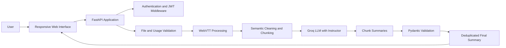

# AI Meeting Assistant

AI Meeting Assistant is a full-stack application that converts meeting transcripts into structured, actionable notes. It uses FastAPI and a Groq-hosted language model to identify meeting overviews, discussion points, decisions, tasks, and deadlines.

The project demonstrates practical applied AI integration, token-efficient transcript processing, authentication, database-backed usage controls, and an interactive frontend.

## Demo

https://github.com/user-attachments/assets/0249c82b-5699-456b-9f8c-0a7602c311f1

## Project Highlights

- Processes `.vtt` meeting transcripts
- Generates structured summaries with Pydantic schema validation
- Removes transcript artifacts, filler language, and repetition
- Uses semantic, topic-aware chunking for long transcripts
- Consolidates chunk summaries into a deduplicated final result
- Provides login and signup functionality with JWT authentication
- Tracks user usage and applies file-size and summary limits
- Displays summaries using an animated typewriter effect
- Supports copying summaries and exporting PDFs
- Locks summarization controls until the complete summary finishes rendering

## Application Features

### Transcript Processing

The backend accepts WebVTT transcript files and validates their type and contents before processing. It:

- Identifies speaker labels when available
- Removes artifacts and extra whitespace
- Filters filler words and repeated phrases
- Repairs fragmented phrases
- Detects topic changes through semantic similarity
- Divides transcripts into manageable chunks

### AI-Powered Summarization

Groq’s `openai/gpt-oss-120b` model is integrated through Instructor to produce schema-validated JSON responses. Each transcript chunk is summarized separately, merged, and processed through a final consolidation pass.

The output contains:

- Meeting overview
- Key discussion points
- Tasks and deadlines
- Decisions and supporting rationale

### Authentication and Usage Controls

Authentication uses bcrypt password hashing and JWT access tokens stored in HTTP-only cookies.

Backend safeguards include:

- Email and password validation
- Duplicate-account prevention
- Maximum upload size limits
- Per-user file-size limits
- Per-user summary limits
- Session refresh and protected API endpoints

### Interactive Frontend

The frontend provides authentication pages and a meeting dashboard. During summarization, it displays processing status and disables uploading, removal, summarization, copying, and PDF export until the complete summary has finished rendering.

## Technical Stack

| Area | Technologies |
|---|---|
| Backend | Python, FastAPI |
| AI / LLM | Groq, Instructor, OpenAI GPT-OSS 120B |
| Data Validation | Pydantic |
| Database | SQLAlchemy, relational database models |
| Database Migrations | Alembic |
| Authentication | bcrypt, JWT, HTTP-only cookies |
| Transcript Processing | WebVTT, Sentence Transformers, WtP-Split, tiktoken, Transformers |
| Frontend | HTML, CSS, JavaScript |
| PDF Export | jsPDF |

## System Architecture

## Engineering Highlights

- **Structured AI output:** Pydantic models enforce consistent JSON structures for reliable frontend rendering.
- **Token awareness:** tiktoken estimates raw and chunked input sizes and reports token reduction metrics.
- **Semantic chunking:** Sentence embeddings detect topic shifts instead of dividing transcripts arbitrarily.
- **Speaker context:** Speaker-tagged transcripts preserve ownership and dialogue context when available.
- **Controlled concurrency:** Chunk summarization uses an asyncio semaphore to limit simultaneous requests.
- **Prompt safeguards:** Prompts require concrete, supported information and prevent invented tasks or decisions.
- **State-driven UI:** The frontend separates normal disabled states from active summarization and unlocks controls only after the summary finishes typing.

## API Areas

| Area | Purpose |
|---|---|
| `/user/signup` | Create a user and initialize usage tracking |
| `/user/login` | Authenticate a user and issue a JWT cookie |
| `/user/refresh` | Validate or refresh an authenticated session |
| `/meeting/summarize` | Validate, preprocess, summarize, and return meeting notes |

## Database Models

- `User` stores user identity, email, and hashed password.
- `Usage` tracks uploaded file size and summary count for each user.

Alembic migrations manage database schema changes independently from application startup.

## Supported Output

The application generates:

- A concise meeting overview
- Important discussion topics
- Explicit tasks and deadlines
- Final decisions and supporting rationale
- PDF and clipboard-ready formats

## Current Scope

The implementation currently supports `.vtt` meeting transcripts. Authentication and usage controls provide a working foundation, with additional production improvements potentially including distributed rate limiting, account recovery, cloud deployment, and strengthened secret management.

## Author

**Rohan Patel**  
Computer Science graduate focused on AI/ML engineering, backend development, and building practical applications that connect language models to structured workflows.

- GitHub: [Rohanpatel512](https://github.com/Rohanpatel512)
